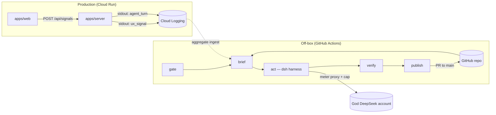
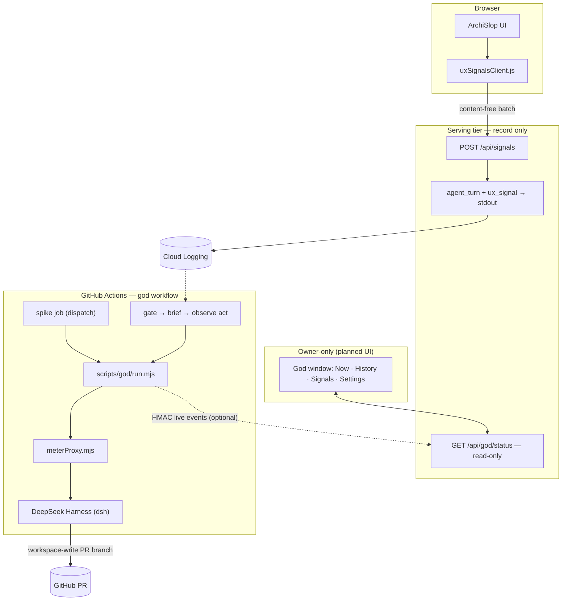
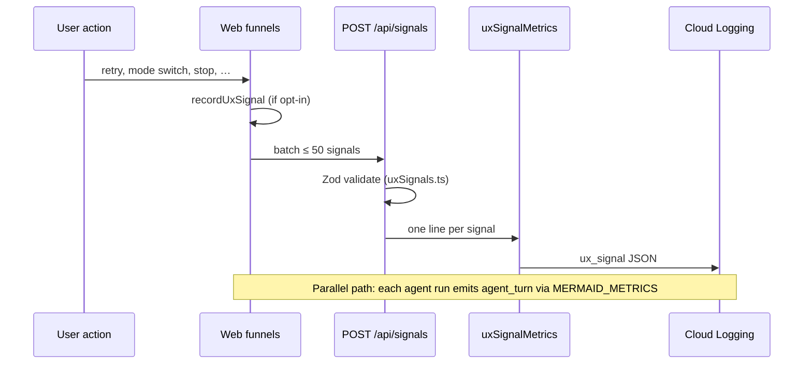
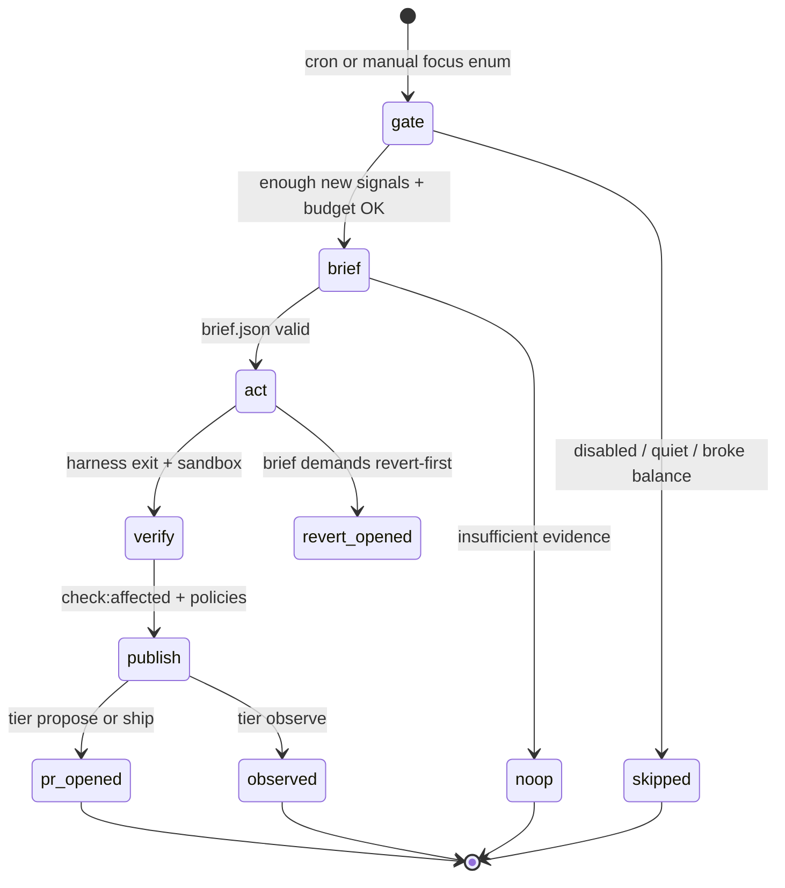

# ArchiSlop God — idea, architecture, and delivery status

ArchiSlop God is a **scheduled, off-box agent** that watches **anonymous production usage** and
improves the **repository** (gates, prompts, funnels, repair paths) by opening pull requests. It does
**not** edit live sessions, hot-patch Cloud Run, or read what users type.

The canonical decision record is [ADR-0019](../decisions/0019-archislop-god.md). This page is the
human-facing map: what problem it solves, how data flows, what is shipped today, and what is still
planned.

| If you want…                                   | Read                                                                                       |
| ---------------------------------------------- | ------------------------------------------------------------------------------------------ |
| Privacy — what is collected                    | [Anonymous usage signals](privacy.md)                                                      |
| Env switches (`MERMAID_METRICS`, `UX_SIGNALS`) | [Configuration](configuration.md)                                                          |
| `POST /api/signals`                            | [API endpoints](api-endpoints.md)                                                          |
| Operator playbook (when God runs)              | [`docs/automations/god.md`](../automations/god.md)                                         |
| Code touch map                                 | [`docs/agent-blast-radius.md`](../agent-blast-radius.md) § Usage signals and ArchiSlop God |

## The idea in one paragraph

Users generate failures, retries, mode switches, and repair outcomes every day. Those patterns are
useful for prioritising engineering work, but only if the product can **observe** them without
storing prompts or diagram text. God consumes **aggregated counts and rates** from production logs,
combines them with repo state (playbook, ledger, prior runs on the `god-log` branch), and runs a
**bounded** harness session that may open a PR. Production **records** signals; it never **starts**
God — same “record, never trigger” line as the office layer ([ADR-0010](../decisions/0010-cast-agency-sign-off.md)).

## How God differs from the night fleet

|                                | NFR routines (`review`, `improve`, …) | Feature automations (`metaphor3d`, `anything`, …) | **ArchiSlop God**                             |
| ------------------------------ | ------------------------------------- | ------------------------------------------------- | --------------------------------------------- |
| **Input**                      | Repo, backlog, ratchet                | Repo + benches                                    | Repo + **production signal brief**            |
| **Host**                       | Claude Routines / Cursor              | Claude Routines                                   | **GitHub Actions** (third host)               |
| **Schedule**                   | Night ladder (23:00–08:45 HKT)        | Night ladder (slot producers)                     | **Day window** 06:00–12:00 UTC (when enabled) |
| **Touches user session slots** | Never                                 | Never                                             | Never                                         |
| **Default autonomy**           | Self-merge when green                 | Self-merge when green                             | **Propose** — owner merges PR                 |
| **Money**                      | Host subscription / Cursor            | Host + optional LLM benches                       | **Separate DeepSeek prepaid** account         |

Solid arrows are **shipped or in repo** today; the dashed ingest line is the **brief** job reading
aggregates from Cloud Logging (hourly when enabled). The **act** job runs **observe** only when
that brief is live and sufficient. Propose then opens a ready pull request. Ship does not merge
(see [Current state](#current-state-shipped-vs-planned)).

## End-to-end architecture (trust boundaries)

Three boxes matter: the **browser**, the **serving** process, and the **runner**. Credentials and
autonomy increase only on the runner side, and each job holds **one** kind of secret.

**Rules encoded in this shape:**

1. **No steering from visitors** — signals are enums and bounded numbers; the brief God reads has no
   free text from production ([`godSchemas.ts`](../../packages/shared/src/godSchemas.ts)).
2. **No in-place production edits** — every change is a PR; merge deploys like any other contributor.
3. **God’s rails are frozen** — `scripts/god/**`, `godBudget.ts`, `godSchemas.ts`, `uxSignals.ts`, and
   `.github/workflows/god.yml` are human-PR-only (`routine-guard` `ALWAYS_FORBIDDEN`).
4. **Separate money** — God bills a dedicated DeepSeek balance; a metering proxy returns HTTP 402 past
   the per-run cap so the harness never holds the real key after startup.

## What production records (signal path)

Field-level detail and opt-out: [privacy.md](privacy.md). Schema source:
[`packages/shared/src/uxSignals.ts`](../../packages/shared/src/uxSignals.ts).

## One God run (pipeline)

Each run follows the same phases as other shelf automations — but the **brief** step is
deterministic from logs, not from issues or PR comments (public-repo injection boundary). The
hourly cron runs **gate → brief**, then act when the live brief clears the evidence bar.
**Observe** records a finding. **Propose** opens a ready pull request after verify. **Ship** does
not merge.

| Tier      | What it may do                                                  |
| --------- | --------------------------------------------------------------- |
| `observe` | Read-only sandbox; narrate findings; no PR                      |
| `propose` | Open a **ready** PR; owner merges (default)                     |
| `ship`    | `gh pr merge --auto` after required checks (runtime setting)    |
| `revert`  | **Forced** when the brief blames God’s last merge — revert only |

Tiers and focus enums: [`godSchemas.ts`](../../packages/shared/src/godSchemas.ts). Hard caps on time
and money: [`godBudget.ts`](../../packages/shared/src/godBudget.ts).

## Memory and visibility

| Store                            | What it holds                                                         | Who writes                       |
| -------------------------------- | --------------------------------------------------------------------- | -------------------------------- |
| Cloud Logging                    | Raw `ux_signal` / `agent_turn` lines                                  | Production server                |
| `god-log` git branch             | One run record per execution (`runs/`), each with `reason` + `digest` | Gate/brief jobs (hourly noop)    |
| `god-log` `index/<month>.json`   | Gate reason per tick — an audit rollup, not a ledger                  | The record job                   |
| `docs/automations/ledger/god.md` | Human/agent-readable run log rows                                     | God PRs                          |
| GitHub repo variables            | `GOD_ENABLED`, `GOD_AUTONOMY`, window, caps                           | Owner via Settings API (planned) |

Cadence (`GOD_EVERY_HOURS`) and the monthly cap (`GOD_MAX_USD_PER_MONTH`) are summed from
`runs/*.json`, the durable store — never from the month rollup. The rollup is still what the owner view
reads, though, because `runs/` cannot be listed over raw HTTPS: so the fold **stamps the true month
totals** (`ticks`, `acts`, `monthSpendUsd`, `lastActAt`) onto the rollup from the records, and
`GET /api/god/status` reports `numbersFrom` to say which it used. Without that stamp a rollup whose
rows were truncated would report a month 54x too small — October 2026, where one surviving row sat
beside 54 records and $0.018813 of real spend. Each record carries `reason` (an enum:
the gate's vocabulary plus `decideAct`'s), `digest` (the brief's five counts and `sufficient`) and
`narration` (what the final text did with the observe contract: `finding`, `waiting` or `dropped`), so
the branch alone answers "why did that tick do nothing, and how close was it to doing something?" —
the question an idle God otherwise cannot answer once the CI log expires. The stamp adds
`unproductiveActs` / `unproductiveUsd`: acts that billed, completed, named nothing and left no
artifact. Those two are **absent rather than zero** when the month's acts predate `narration` —
"not measured" and "measured clean" are different answers about money, and October is the former.
See [the playbook § 6 Memory](../automations/god.md#6-memory).

Live run streaming (`events.ndjson` → owner **Now** tab) uses HMAC-signed POSTs to
`POST /api/god/live` ([`ingestClient.mjs`](../../scripts/god/ingestClient.mjs)); delivery is
best-effort — the durable artifact is the run report, not the websocket-like view.

## Current state: shipped vs planned

| Piece                                        | Status                                              | Location                                                                       |
| -------------------------------------------- | --------------------------------------------------- | ------------------------------------------------------------------------------ |
| Client usage signals + opt-out               | **Shipped**                                         | `apps/web/src/state/uxSignalsClient.js`, Settings storage                      |
| `POST /api/signals`                          | **Shipped**                                         | `apps/server/src/routes/signals.ts`                                            |
| `agent_turn` metrics                         | **Shipped**                                         | `apps/server/src/metrics/agentTurnMetrics.js`                                  |
| Shared signal + God wire schemas             | **Shipped**                                         | `uxSignals.ts`, `godSchemas.ts`, `godBudget.ts`                                |
| Run wrapper, meter proxy, dsh adapter, spike | **Shipped**                                         | `scripts/god/`                                                                 |
| `gate` + `brief` + observe decision          | **Shipped**                                         | `scripts/god/gate.mjs`, `scripts/god/brief.mjs`, `scripts/god/actDecision.mjs` |
| Multi-metric, history-aware brief            | **Shipped**                                         | `scripts/god/brief.mjs` (`buildFindings`, `deriveLastGodMerge`)                |
| CI workflow (hourly `gate → brief → act`)    | **Shipped** — cron `17 * * * *`, window `06–12` UTC | `.github/workflows/god.yml`                                                    |
| Harness spike (`workflow_dispatch`)          | **Shipped**                                         | same workflow / `scripts/god/spike.mjs`                                        |
| Observe act (read-only, god-log finding)     | **Shipped**                                         | `scripts/god/run.mjs`, `scripts/god/godLog.mjs`, `scripts/god/recordTick.mjs`  |
| Propose verify → ready PR                    | **Shipped**                                         | `scripts/god/proposePatch.mjs`, `.github/workflows/god.yml`                    |
| Ship (`gh pr merge --auto`)                  | **Planned**                                         | ADR-0019; ledger § Open observations                                           |
| `GET /api/god/status` — owner run view       | **Shipped** (read-only)                             | `apps/server/src/god/godLogView.ts`, `apps/server/src/routes/godStatus.ts`     |
| Window UI + `/api/god` settings writes       | **Planned** — needs the narrow Actions token        | ADR-0019 §10                                                                   |

**Practical today:** production emits signals; GitHub Actions runs an hourly **gate → brief** tick
(when `GOD_ENABLED` and budget allow) and writes run records to **`god-log`**. The brief ranks
worsening across all ten God metrics (per-slot accept, failure, retry, restore, manual-edit and
render-repair rates, repair burden and p90 latency, plus product-wide client errors and session
bounce), deprioritises findings God acted on in the last seven days, and derives the last God
merge from god-log history so revert-first can blame God's own deploy. When the brief is from live
logs and sufficient, act runs. **Observe** records one finding. **Propose** opens a ready pull
request after the path budget and `check:affected`; it does not merge. `GOD_ENABLED` stays off
until the owner turns it on. The spike remains available for harness validation.

## Related decisions

- [ADR-0019](../decisions/0019-archislop-god.md) — full decision, alternatives, consequences
- [ADR-0018](../decisions/0018-green-builds-self-healing-and-the-two-minute-ask.md) — ready PRs,
  auto-merge, six required checks (God `ship` tier stays behind the same gate)
- [ADR-0010](../decisions/0010-cast-agency-sign-off.md) — no autonomous slot content; God improves
  the repo, not a user diagram
